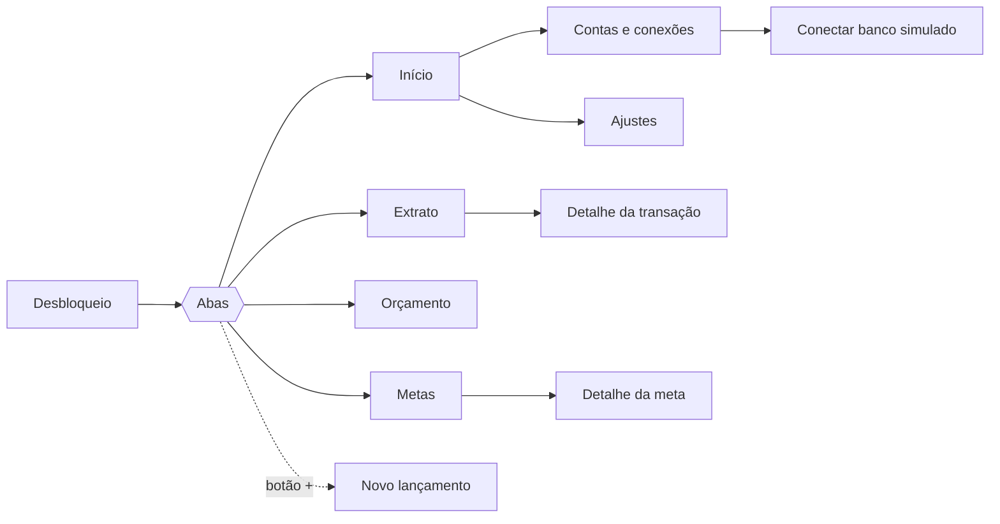

# Telas e roteiro da demo

As telas do app mobile e o roteiro do vídeo de cerca de 30 segundos da AT2-N2. O que cada funcionalidade faz está no [escopo](escopo.md); cores, fontes e temas, no [design](design.md).

## Navegação

## Telas
| Tela | O que mostra e faz |
|---|---|
| **Desbloqueio** | Logo e pedido de biometria. Abre sozinho ao iniciar e ao voltar do segundo plano. |
| **Início** | Saldo somado das contas; anel do gasto do mês contra o orçamento total; as três categorias que mais gastaram; últimas transações; atalhos para contas e ajustes. |
| **Extrato** | Transações agrupadas por dia, com seletor de mês, filtros de conta e categoria e busca. Despesa com "−" na cor do texto, receita com "+" em verde (`income`); parcela mostrada como "2/3". |
| **Detalhe da transação** | Conta, data, valor, categoria (trocável), observação. Lançamento manual tem "Excluir". |
| **Novo lançamento** | Botão "+" nas abas. Tipo (despesa/receita), valor digitado em centavos, descrição, conta, categoria, data e, se a conta for cartão, número de parcelas. |
| **Orçamento** | Seletor de mês; por categoria, barra de gasto contra limite na cor da categoria, que passa a âmbar com "Atenção" a partir de 80% e a laranja com "Estourou" acima de 100% ([design](design.md)), e "já comprometido" em destaque; edição dos limites. |
| **Metas** | Cartões com nome, progresso e quanto falta. "Nova meta". |
| **Detalhe da meta** | Progresso, data-alvo, lista de aportes, "Novo aporte" e "Retirar". |
| **Contas e conexões** | Contas agrupadas por banco, com saldo; "Nova conta manual"; "Conectar banco". |
| **Conectar banco simulado** | Lista de bancos fictícios → consentimento (que dados serão lidos, com o aviso "simulação") → "Sincronizando…" → resumo do que foi importado. |
| **Ajustes** | Desbloqueio por biometria liga/desliga; tema (Sistema, Claro, Escuro); "Restaurar dados de exemplo". |

Toda lista tem estado vazio com uma ação (ex.: "Nenhuma meta ainda. Criar meta").

## Roteiro do vídeo (~30 s)
| Tempo | Cena | O que prova |
|---|---|---|
| 0–3 s | Abre o app, desbloqueia com a digital | Segurança |
| 3–8 s | Início: saldo de todas as contas e gasto do mês | Visão do todo (problema 1) |
| 8–13 s | Conecta um banco fictício; as transações dele aparecem no extrato | Open Finance (simulado) |
| 13–17 s | Troca a categoria de uma transação | Extrato sob controle do usuário |
| 17–24 s | Lança uma compra de R$ 300 em 3x no cartão; o orçamento mostra R$ 100 no mês e R$ 100 "já comprometido" no seguinte | Parcelas no mês certo (problema 2) |
| 24–30 s | Faz um aporte numa meta e a barra avança | Metas (problema 3) |

Para a apresentação em sala, ensaiar o mesmo roteiro com os dados de exemplo restaurados, para a demo sair igual ao vídeo.
